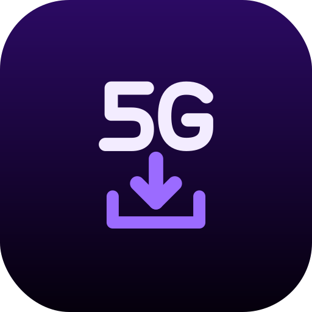

<div align="center">
  
  <h1>Mi5G Dl</h1>
  <p><strong>Personal Android media downloader build for <a href="https://x.com/midroid5G">@midroid5G</a>.</strong></p>
  <p><strong>Based on <a href="https://github.com/MaverickRox/VRKA-Android">VRKA by MVRK (MaverickRox)</a>, GPL-3.0.</strong></p>
  <p>
    <a href="https://github.com/al3nkboot/mi5g-dl/releases/latest"></a>
    <a href="https://paypal.me/Midroid5G"></a>
    <a href="https://x.com/midroid5G"></a>
  </p>
</div>

---

> يُوزَّع التطبيق عبر GitHub فقط، وليس عبر Google Play. / Distributed via GitHub only, not Google Play.

<div dir="rtl">

## العربية

محمّل وسائط لأندرويد، مبني على مشروع VRKA برخصة GPL-3.0. الواجهة تدعم العربية واتجاه اليمين إلى اليسار. التحديثات من GitHub فقط، ومجلّد التنزيل الافتراضي هو «التنزيلات / Mi5G Dl».

</div>

## Attribution

> **Based on VRKA by MVRK (MaverickRox), GPL-3.0** — https://github.com/MaverickRox/VRKA-Android
>
> Mi5G Dl is a rebranded fork of VRKA Android 5.1.5 (upstream commit
> `0d721d0b6c084c854f642b0e62027a3195521e74`). All credit for the downloader engine,
> browser fallback, UI and architecture goes to the upstream author. The original upstream
> README is preserved unchanged in [README-VRKA-UPSTREAM.md](docs/reports/README-VRKA-UPSTREAM.md).
> Desktop VRKA: https://github.com/MaverickRox/VRKA

## Modification notice (GPL-3.0 §5a)

This is a **modified version** of VRKA Android, changed by @midroid5G. See
[MODIFICATIONS.md](docs/reports/MODIFICATIONS.md) for the full list. In short:

- App name `Mi5G Dl`, applicationId `com.midroid.mi5gdl` (installs alongside VRKA; Kotlin package `com.mvrk.vrka` left unchanged).
- New launcher/notification icon ("5G" + download arrow, dark purple). Purple accent + AMOLED black theme kept.
- Default download folder `Download/Mi5G Dl`.
- Upstream VRKA self-updater **disabled**: upstream VRKA APKs are never installed over this app. yt-dlp and uBlock Origin component updates work as upstream.
- Self-update from this repo only (`al3nkboot/mi5g-dl`): public GitHub releases, no token required; the APK is checked for size, SHA-256, package, versionCode and signing certificate before install.
- Optional YouTube sign-in and bot-check recovery, Drive-file settings/history sync, and a precise-cut trim option.
- 1.3.0 (versionCode 7) merges upstream VRKA Android 5.1.5: Room/SQLite queue and history with crash-safe publishing, full Arabic (and 13 other languages) plus RTL, GeckoView 159, playlist child jobs, share sheet, and pre-download size estimates.
- 1.3.1 (versionCode 8) restores the Mi5G Dl home-screen wordmark and remaining user-visible branding after the 5.1.5 merge.

### Releases / self-update convention

- Tag: `vX.Y.Z`
- APK asset: `Mi5G-Dl-X.Y.Z-arm64.apk`
- `update.json` asset:
  ```json
  {"versionCode":N,"versionName":"X.Y.Z","apk":"Mi5G-Dl-X.Y.Z-arm64.apk","sha256":"…"}
  ```
- The APK must be signed with the same key as the installed app, or the app refuses the update.

## What it does

Native Kotlin/Jetpack Compose downloader: yt-dlp (+ FFmpeg, arm64-v8a) for direct extraction,
with a GeckoView browser fallback (uBlock Origin + media-detector WebExtension) for pages
yt-dlp cannot read directly. Persistent Room queue and history, format/resolution/audio selection,
subtitles, custom yt-dlp argument templates, optional H.264 conversion. Does not bypass DRM
or access controls. arm64-v8a only, Android 8.0+.

The app contains no application analytics, advertising, or telemetry SDK. Network
destinations and data exposure are recorded in [docs/PRIVACY_NETWORK.md](docs/PRIVACY_NETWORK.md).

Existing 1.2.x queue and history in `download_jobs.json` are imported into Room on first launch of 1.3.0 (including trim, playlist group/folder, and sync origin fields). The original JSON file is kept as a migration backup.

## Building

Requirements: JDK 17 for assemble (JDK 21 for Robolectric unit tests — Android SDK 36),
Android SDK platform `android-37.2` (compileSdk 37.2, targetSdk 36),
build-tools 36.1+/37.0.0. No NDK needed (native libs are prebuilt AARs). ~3 GB Gradle heap.

```bash
./gradlew --no-daemon assembleDebug          # app/build/outputs/apk/debug (id com.midroid.mi5gdl.debug)
VRKA_SIGNING_PROPERTIES=/path/to/signing.properties ./gradlew --no-daemon assembleRelease
```

The release signing keystore is kept **outside** this repository and must never be committed.

## 💙 Support Development / دعم استمرارية تطوير التطبيق

If you find **Mi5G Dl** useful, you can support the developer **`@midroid5G`**:

<div dir="rtl">

إذا أعجبك التطبيق واستفدت منه، يمكنك دعم المطوّر للمساهمة في استمرار تطوير التطبيق وتحديثه مجاناً ومن دون إعلانات:

</div>

- **PayPal:** [**paypal.me/Midroid5G**](https://paypal.me/Midroid5G) (`@midroid5G`)
- **X (Twitter):** [**@midroid5G**](https://x.com/midroid5G)

## License

GNU General Public License v3.0 — see [LICENSE](LICENSE). Mi5G Dl remains GPL-3.0 like upstream VRKA.
Third-party components keep their own licenses — see [THIRD_PARTY_NOTICES.md](THIRD_PARTY_NOTICES.md)
(GeckoView MPL-2.0, uBlock Origin GPL-3.0, yt-dlp Unlicense, youtubedl-android Apache-2.0,
FFmpeg LGPL-2.1+, Space Mono OFL-1.1, Kyant0/backdrop Apache-2.0 vendored sources).
