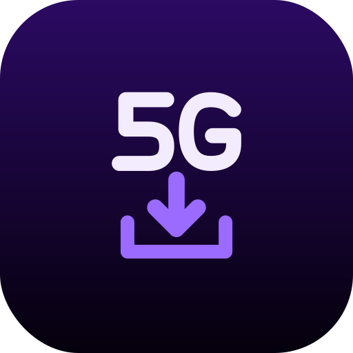

<div align="center">
  
  <h1>Mi5G Dl</h1>
  <p><strong>Personal Android media downloader build for <a href="https://x.com/midroid5G">@midroid5G</a>.</strong></p>
  <p><strong>Based on <a href="https://github.com/MaverickRox/VRKA-Android">VRKA by MVRK (MaverickRox)</a>, GPL-3.0.</strong></p>
</div>

---

## Attribution

> **Based on VRKA by MVRK (MaverickRox), GPL-3.0** — https://github.com/MaverickRox/VRKA-Android
>
> Mi5G Dl is a rebranded fork of VRKA Android 5.0.2 (upstream commit
> `06524a676c8d1045fcc50e45a9bce8bfe737fa58`). All credit for the downloader engine,
> browser fallback, UI and architecture goes to the upstream author. The original upstream
> README is preserved unchanged in [README-VRKA-UPSTREAM.md](README-VRKA-UPSTREAM.md).
> Desktop VRKA: https://github.com/MaverickRox/VRKA

## Modification notice (GPL-3.0 §5a)

This is a **modified version** of VRKA Android, changed by midroid5G on 2026-10-09.
See [MODIFICATIONS.md](MODIFICATIONS.md) for the full list. In short:

- App name `Mi5G Dl`, applicationId `com.midroid.mi5gdl` (installs alongside VRKA; Kotlin package `com.mvrk.vrka` left unchanged).
- New launcher/notification icon ("5G" + download arrow, dark purple). Purple accent + AMOLED black theme kept.
- Default download folder `Download/Mi5G Dl`.
- Upstream VRKA self-updater **disabled**: upstream VRKA APKs are never installed over this app. yt-dlp and uBlock Origin component updates work as upstream.
- 1.1.0 (versionCode 2) adds:
  - **Share to download**: a compact bottom sheet for links shared from other apps, with Video/Audio, Trim and a one-tap Download. You can turn on "skip sheet" in Settings.
  - **Trim before download**: start/end times, a range slider and an optional precise cut. Uses yt-dlp `--download-sections`; an FFmpeg fallback handles browser-assisted downloads.
  - **Self-update from this repo only** (`al3nkboot/mi5g-dl`): before installing, it checks the APK's size, SHA-256, package, versionCode and signing certificate.
- 1.1.1 (versionCode 3): the self-updater works **without a token**, because the repository is public.
  - Each check makes one unauthenticated API call. GitHub allows 60 per hour per IP, and the daily background check uses one.
  - The APK and `update.json` are downloaded from their public `browser_download_url`, which doesn't count against the API limit.
  - If GitHub rate-limits a check, the app shows when to try again and retries once after the reset time.
  - An optional fine-grained token (read-only *Contents*, this repo only) can be added under Settings → Mi5G Dl App Updates → *Advanced*. It's only needed if the repo becomes private, or to raise the rate limit. It's stored with Android Keystore and sent only to `api.github.com`.
  - **Settings & history sync** through one JSON file on Google Drive, picked with the system file picker (no sign-in). It never syncs secrets or the download folder.
- 1.1.2 (versionCode 4): YouTube "Sign in to confirm you're not a bot" fix.
  - The bot check is classified as an auth problem (it used to be treated as a cookie problem and sent to the browser fallback). yt-dlp is retried up to twice with other YouTube clients (`--extractor-args youtube:player_client=…`) and back-off.
  - YouTube links never go to the browser fallback. The YouTube web player streams through SABR/UMP, which the media detector can't capture.
  - If YouTube still refuses, Queue and History say so plainly and suggest Retry, sign-in or a yt-dlp update.
  - **YouTube account (optional)** in Settings: you sign in through a private built-in browser. youtube.com/google.com cookies are saved to app-private no-backup storage and passed with `--cookies` for YouTube links only. They are never synced or logged, and Sign out deletes them. Google may block sign-in in embedded browsers.
  - New installs use the yt-dlp **Nightly** channel by default.
  - The browser fallback now shows page loading and load errors instead of a silent blank view.

### Releases / self-update convention

- Tag: `vX.Y.Z`
- APK asset: `Mi5G-Dl-X.Y.Z-arm64.apk`
- `update.json` asset:
  ```json
  {"versionCode":N,"versionName":"X.Y.Z","apk":"Mi5G-Dl-X.Y.Z-arm64.apk","sha256":"…"}
  ```
- The APK must be signed with the same key as the installed app, or the app refuses the update.

## What it does

Native Kotlin/Jetpack Compose downloader: yt-dlp (+ FFmpeg, arm64-v8a) for direct extraction,
with a GeckoView browser fallback (uBlock Origin + media-detector WebExtension) for pages
yt-dlp cannot read directly. Persistent queue, history, format/resolution/audio selection,
subtitles, custom yt-dlp argument templates, optional H.264 conversion. Does not bypass DRM
or access controls. arm64-v8a only, Android 8.0+.

## Building

Requirements: JDK 17, Android SDK platform `android-37.1` (compileSdk 37.1, targetSdk 36),
build-tools 36.1+/37.0.0. No NDK needed (native libs are prebuilt AARs). ~2 GB Gradle heap.

```bash
./gradlew --no-daemon assembleDebug          # app/build/outputs/apk/debug (id com.midroid.mi5gdl.debug)
VRKA_SIGNING_PROPERTIES=/path/to/signing.properties ./gradlew --no-daemon assembleRelease
```

The release signing keystore is kept **outside** this repository and must never be committed.

## License

GNU General Public License v3.0 — see [LICENSE](LICENSE). Mi5G Dl remains GPL-3.0 like upstream VRKA.
Third-party components keep their own licenses — see [THIRD_PARTY_NOTICES.md](THIRD_PARTY_NOTICES.md)
(GeckoView MPL-2.0, uBlock Origin GPL-3.0, yt-dlp Unlicense, youtubedl-android Apache-2.0,
FFmpeg LGPL-2.1+, Space Mono OFL-1.1, Kyant0/backdrop Apache-2.0 vendored sources).
